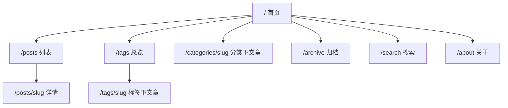

# AI Blog 前端设计说明

> 版本 v1.0（一期）· 2026-10-31
> 定位：个人博客，阅读优先、渐进增强、脚本克制。
>
> **本文只讲设计**：信息架构、视觉、布局、页面、组件、渲染、交互、SEO、性能预算。
> 技术选型、分层、数据库与 API 端点见 `ARCHITECTURE.md`（本文引用而不重复）。

## 目录

1. [设计目标与原则](#1-设计目标与原则)
2. [信息架构与路由](#2-信息架构与路由)
3. [视觉系统](#3-视觉系统)
4. [布局与响应式](#4-布局与响应式)
5. [页面设计](#5-页面设计)
6. [组件体系](#6-组件体系)
7. [渲染与数据获取](#7-渲染与数据获取)
8. [Markdown 渲染管线](#8-markdown-渲染管线)
9. [交互细节](#9-交互细节)
10. [状态设计](#10-状态设计)
11. [无障碍与 SEO](#11-无障碍与-seo)
12. [性能预算](#12-性能预算)
13. [前端目录结构](#13-前端目录结构)

---

## 1. 设计目标与原则

用户到这个站点只做一件事：**读**。所有取舍服从这一点。

| 目标 | 具体要求 |
| --- | --- |
| 阅读优先 | 正文 17px / 行高 1.85 / 行宽 68ch，任何装饰不挤压正文 |
| 首屏快 | 服务端直出可读文本，LCP < 2.0s（p75） |
| 脚本少 | 首路由 JS < 80KB gzip；正文零 JS，交互点用小岛隔离 |
| 稳 | 无 JS 可读、可翻页、可搜索；图片禁用也能看懂结构 |
| 一致 | 一套设计令牌驱动颜色/间距/圆角，暗色重新定值而非反色 |

**三条原则**

1. **内容即界面**：不用大面积色块抢注意力，留白承担层级，边框承担分区。
2. **渐进增强**：JS 只增强（防抖、滚动高亮、复制、抽屉），不承担必要功能。
3. **克制动效**：仅状态切换 150~200ms，`prefers-reduced-motion` 下全部关闭。

**明确不做**：轮播、视差、鼠标跟随、滚动触发动效、卡片 3D。

---

## 2. 信息架构与路由



| 路由 | 渲染 | 数据来源 | 说明 |
| --- | --- | --- | --- |
| `/` | ISR 60s | `/posts?featured=1`、`/posts?pageSize=6` | 精选 + 最新 |
| `/posts` | ISR 60s | `/posts?page=` | 分页列表 |
| `/posts/[slug]` | ISR 300s | `/posts/:slug`、`/posts/:slug/related` | 正文页 |
| `/tags` | ISR 300s | `/tags` | 标签总览 |
| `/tags/[slug]` | ISR 120s | `/posts?tag=` | 复用列表布局 |
| `/categories/[slug]` | ISR 120s | `/posts?category=` | 复用列表布局 |
| `/archive` | ISR 300s | `/archive` | 年 → 月 → 文章 |
| `/search` | SSR 动态 | `/search?q=` | 输入驱动 |
| `/about` | ISR 600s | `/site/meta` | 关于本站 |
| `/api/revalidate` | Route Handler | — | 接收 `api` 的失效通知 |
| `not-found` / `error` | 静态 | — | 全局兜底 |

URL 规范：全小写、连字符、无尾斜杠；分页 `?page=2`，搜索 `?q=`（可分享可收藏）。筛选一次只允许一个维度（`tag` / `category` 不同时出现），避免参数组合爆炸。

导航固定 4 项：文章、标签、归档、关于；搜索是常驻图标，不占一级导航位。

---

## 3. 视觉系统

### 3.1 设计令牌

Tailwind v4 `@theme` 定义一次，全站只引用语义名，不写裸色值。

```css
/* apps/web/src/styles/globals.css */
@theme {
  --color-bg: #ffffff;
  --color-bg-subtle: #f7f7f8;
  --color-fg: #17181c;
  --color-fg-muted: #5f6470;
  --color-fg-faint: #8b909c;
  --color-border: #e6e7eb;
  --color-accent: #2f6fed;
  --color-accent-weak: #eaf0fe;

  --radius-sm: 6px; --radius-md: 10px; --radius-lg: 16px;
  --font-sans: "Inter", -apple-system, "PingFang SC", "Microsoft YaHei", sans-serif;
  --font-mono: "JetBrains Mono", ui-monospace, monospace;
  --text-body: 1.0625rem;
  --leading-body: 1.85;
}

[data-theme="dark"] {
  --color-bg: #101114;      --color-bg-subtle: #17181d;
  --color-fg: #e8e9ed;      --color-fg-muted: #a2a7b3;
  --color-fg-faint: #767c8a; --color-border: #262831;
  --color-accent: #7aa2ff;  --color-accent-weak: #1b2333;
}

@custom-variant dark (&:where([data-theme="dark"], [data-theme="dark"] *));
```

| 令牌 | 用途 | 约束 |
| --- | --- | --- |
| `bg` / `bg-subtle` | 页面底 / 卡片与代码底 | 亮度差 ≤ 4%，不刺眼 |
| `fg` / `fg-muted` / `fg-faint` | 正文 / 次要 / 时间计数 | 对比度 ≥ 7:1 / 4.5:1 / 3:1 |
| `border` | 分隔线、卡片描边 | 全站 1px，不用阴影分区 |
| `accent` | 链接、当前页、焦点环 | 大面积仅限选中背景与按钮 |
| 字号 | 正文 17 / 小字 14 / 注释 13 / H1 32~40 | 用 `clamp()` 流体，不做断点跳变 |
| 圆角 | 标签 999 / 卡片 10 / 容器 16 | 同一元素不混用 |

### 3.2 字体与行宽

- 自托管 Inter `latin` 子集（woff2，`swap`，`preload`）；**中文不引 webfont**，走系统字体（体积不可控）。
- 正文 `max-w-[68ch]`（约 680px）；代码块允许横向滚动，不撑破视口。
- 中文段落左对齐，不用 `text-align: justify`（字间距难看）。

### 3.3 暗色模式

- `data-theme` 挂 `<html>`，三态 `light / dark / system`，默认 `system`。
- 防闪烁：`<head>` 内联脚本，首帧前读 `localStorage` 与 `matchMedia` 写入属性（不能等水合）。
- 切换控件在页头，改值即写 `localStorage` 并同步 `<meta name="theme-color">`。
- 图片不做全局 `invert`，仅极亮封面加 `dark:brightness-90`。

---

## 4. 布局与响应式

| 断点 | 宽度 | 行为 |
| --- | --- | --- |
| base | < 640 | 单列；页头汉堡；TOC 折叠为正文顶部按钮 |
| `sm` | ≥ 640 | 卡片内边距增大；分页显示页码 |
| `md` | ≥ 768 | 列表两列；归档双列 |
| `lg` | ≥ 1024 | 右侧 TOC 出现；列表页左侧筛选边栏 |
| `xl` | ≥ 1280 | 容器定宽居中，留白不再增长 |

- 容器 `max-w-[1120px] px-4 sm:px-6 lg:px-8 mx-auto`；正文页收窄 `max-w-[720px]`，TOC 用 `absolute` 溢出右侧，不挤压正文。
- 列表卡片等高由标题 `line-clamp-2` 保证，不用 `min-h` 硬撑。
- 页头 `sticky top-0 z-40`，无滚动时透明，滚动 > 8px 加 `bg-bg/80 backdrop-blur border-b`。
- `<body>` 用 `min-h-dvh flex flex-col`，页脚自然贴底；移动端不设常驻底部 Tab（导航项少）。

```
┌──────────────────────────────────────────┐
│ Header  站点名 · 文章 标签 归档 关于  🔍 ☾ │
├──────────────────────────────────────────┤
│  <main>                                   │
├──────────────────────────────────────────┤
│ Footer  版权 · RSS · 社交 · 备案           │
└──────────────────────────────────────────┘
```

---

## 5. 页面设计

### 5.1 首页 `/`

| 区块 | 内容 | 细节 |
| --- | --- | --- |
| Hero | H1 站点名、一句简介、社交链接 | `min-h-[38vh]`，无背景图；标题 `clamp(28px,5vw,40px)` |
| 精选 | `featured=true` 最多 3 篇 | 1 大（封面+摘要）+ 2 小（仅标题与时间） |
| 最新 | 最新 6 篇 | 行式（日期 ｜ 标题 ｜ 标签），比卡片省空间 |
| 关于片段 | `site.meta.about` 前 3 行 + 了解更多 | `bg-subtle` 块做视觉分节 |

无精选数据时整块不渲染，不留空标题。

### 5.2 列表 `/posts`

- 行式：标题（H2，整行可点）→ 摘要 `line-clamp-2` → 元信息（日期 · 阅读时长 · 分类 · 前 2 标签）。
- `lg` 起左侧 220px 边栏：分类 + 热门标签（带计数），当前项高亮；小屏改为顶部横向 chip。
- 分页每页 10 篇，`上一页 / 页码 / 下一页`，首尾禁用不隐藏；超过 7 页用省略号折叠。
- hover 只改标题颜色与整行 `bg-subtle`，不做位移阴影。

### 5.3 详情 `/posts/[slug]`

```
面包屑
H1 标题
元信息：发布 · 更新 · 阅读时长 · 浏览量 · 分类 · 标签
──────
封面图（可选 16:9，priority）
正文 Prose                       ┌──────────┐
  H2/H3 带锚点、代码块可复制       │ 目录      │
  引用 / 表格 / 图片 / 脚注        │ 一、背景  │
──────                           │ 二、方案  │
上一篇 / 下一篇                    │ 三、结论  │
相关文章 3 篇                      └──────────┘
```

- 日期用 `<time datetime>`，元信息以 `·` 分隔。
- 标题锚点 hover 出现 `#`，点击复制链接并提示。
- 代码块顶栏显示语言 + 复制按钮，横向滚动，默认行号，超 40 行折叠。
- 图片 `next/image` 自适应，点击开灯箱（支持 `Esc` / `←→`）。
- 上下篇缺失的一侧留空，不用「已是最新」占位。
- 顶部 2px 阅读进度条，`accent` 色，`rAF` 节流。

### 5.4 标签与分类

- `/tags` 按文章数降序，chip 三档字号（1~2 / 3~5 / 6+）；不按首字母分组（中文排序无意义）。
- `/tags/[slug]` 复用列表布局，标题「标签：xxx」+ 计数；无结果走 `not-found`，不返回空列表。
- `/categories/[slug]` 与标签页同构。

### 5.5 归档 `/archive`

年份 H2，月份一行 `10 月 · 3 篇` 下挂文章标题；默认全部展开（文章量小），不增加折叠交互。`md` 起双列，年份块不跨列。

### 5.6 搜索 `/search`

- 页头图标进入即聚焦输入框；防抖 300ms 后 `router.replace('/search?q=...')`，服务端按 `searchParams` 取数。
- 加载用 `useTransition` 顶部细进度条，不用整页骨架（避免输入时闪烁）。
- 命中词由服务端渲染 `<mark>`（`bg-accent-weak`，不加粗）。
- 空查询：提示 + 6 个热门标签建议；无结果：`EmptyState` + 清空 + 标签建议。
- 无 JS：表单 `method="get"`，提交整页跳转，功能完整。

### 5.7 关于 `/about`

单页，`site_meta.about` 的 Markdown 按 Prose 渲染，底部联系方式 + 技术栈一句话。

### 5.8 错误页

- `not-found`：大号 404 + 一句人话 + 「回到首页」「全部文章」两个链接。
- `error`：「加载失败」+ 重试（`reset()`）+ `digest` 编号（便于对照日志）。

---

## 6. 组件体系

### 6.1 Server / Client 边界

默认全部 Server Component，只有下列 8 个叶子节点标 `'use client'`：

| 组件 | 为何必须 Client | 体积 |
| --- | --- | --- |
| `ThemeToggle` | localStorage / matchMedia | < 2KB |
| `MobileNav` | 抽屉开合 + 焦点管理 | < 3KB |
| `SearchInput` | 防抖 + `useRouter` | < 3KB |
| `TocScrollSpy` | `IntersectionObserver` 高亮 | < 2KB |
| `ReadingProgress` | 滚动监听 | < 1KB |
| `BackToTop` | 阈值 + 平滑滚动 | < 1KB |
| `CodeCopy`（单例委托） | 剪贴板 + 事件委托 | < 2KB |
| `ImageLightbox` | 键盘与遮罩交互 | < 4KB |

纪律：① Client 组件不 import 任何含 Node 内置模块的文件（`fs`、`unified` 管线）；② 不把函数 / Date / 类实例作为 props 传给 Client；③ 不设全局 Context，主题只走 `data-theme` 属性。

### 6.2 组件清单

| 分类 | 组件 | 类型 | 说明 |
| --- | --- | --- | --- |
| 布局 | `SiteHeader` / `SiteFooter` / `Container` | Server | 骨架 |
| 布局 | `NavLinks` | Server | 由父级传入 `current`，避免 `usePathname` |
| 通用 | `TagChip` / `CategoryBadge` | Server | 链接 + 计数 |
| 通用 | `PostMeta` | Server | 日期 / 时长 / 浏览量，统一分隔符 |
| 通用 | `Pagination` | Server | 纯 `<Link>`，零 JS |
| 通用 | `EmptyState` / `ErrorState` / `Skeleton` | Server | 三态视觉统一 |
| 文章 | `PostCard` / `PostRow` / `FeaturedPost` | Server | 三种列表形态 |
| 文章 | `ArticleHeader` / `ArticleBody` / `Toc` | Server | 详情三段 |
| 文章 | `PrevNext` / `RelatedPosts` / `ShareBar` | Server | 纯链接，不引分享 SDK |
| 归档 | `ArchiveYear` / `ArchiveMonth` | Server | 年月分组 |
| 搜索 | `SearchResults` / `SearchHighlight` | Server | 结果与高亮 |

`CopyLinkButton` 从 `ShareBar` 拆出，是唯一因剪贴板而 Client 的小岛。

### 6.3 视觉约束

- 卡片 `bg-bg border border-border rounded-lg p-5`，hover 只改描边与标题色。
- 标签 chip `text-xs px-2 py-0.5 rounded-full bg-bg-subtle`，hover 变 `accent-weak`。
- 按钮仅用于空态/错误态：`h-9 px-4 rounded-md`，主 `bg-accent`，次描边。
- 图标全部内联 SVG（`currentColor`），不引图标库，全站不超过 10 个。
- 间距节奏：区块间 `mt-16`，元素间 `mt-4 / mt-2`，不用任意值。

---

## 7. 渲染与数据获取

- 全部取数在 Server Component，**不用 `useEffect` 拉数据**。
- `apps/web/src/lib/api.ts` 是唯一出口：拼 URL、解包 `{ success, data, meta }`、把错误码映射为 `ApiError`、注入 `next: { revalidate, tags }`。
- 前端不做 DTO 转换（时间已是 ISO），只做展示格式化（`Intl.DateTimeFormat('zh-CN')`）。

```ts
const { data } = await api.get<PostDetail>(`/posts/${slug}`, {
  revalidate: 300,
  tags: [`post:${slug}`, 'list'],
})
```

| 页面 | revalidate | cache tag |
| --- | --- | --- |
| 首页 / 列表 | 60s | `list` |
| 详情 | 300s | `post:{slug}`、`list` |
| 标签 / 分类 | 120~300s | `tag:{slug}` / `category:{slug}`、`list` |
| 归档 | 300s | `list`、`archive` |
| 关于 / 站点 | 600s | `site` |

失效通路：`api` 探测到 `max(updated_at)` 变化 → 调 `/internal/revalidate` → Web 的 `/api/revalidate` 校验 token → `revalidateTag`。未收到通知则靠 ISR 时间窗自然过期（最长 300s）。请求失败不缓存错误，交给 `error.tsx`。

流式：详情页「相关文章」单独 `<Suspense>`，正文优先出（次要信息不阻塞 LCP）；`loading.tsx` 只给列表与详情，搜索页用进度条替代骨架。

---

## 8. Markdown 渲染管线

**渲染在 Web 的 Server Component，不在 `api`。** 理由：`api` 保持纯数据出口；样式与高亮主题属于前端资产，改设计不必回滚后端；渲染结果随 ISR 缓存，客户端零成本。

```
content_md
  ↓ remark-parse + remark-gfm
  ↓ remark-rehype
  ↓ rehype-sanitize            白名单：禁 script / iframe / style / on*
  ↓ rehype-slug + rehype-autolink-headings
  ↓ rehype-pretty-code         Shiki，light/dark 双主题
  ↓ hast → JSX
  → contentHtml + toc[]
```

| 插件 | 作用 | 关键配置 |
| --- | --- | --- |
| `remark-gfm` | 表格、删除线、任务列表、自动链接 | 默认 |
| `rehype-sanitize` | 内容来自外部采集，必须清洗 | 放行 `h1~h6 a img code pre table figure figcaption` |
| `rehype-slug` | 标题 id | TOC 复用同一份 id |
| `rehype-autolink-headings` | 标题锚点 | `append`，仅 hover 可见 |
| `rehype-pretty-code` | 代码高亮 | `github-light` / `github-dark`，随 `data-theme` |
| 自定义 rehype | 外链 `target="_blank" rel="noopener noreferrer"` | 仅 `http(s)` |

- **TOC**：只取 H2/H3（H1 是文章标题），扁平两级，最多 12 项，超出折叠。锚点滚动用 `scroll-margin-top: 80px` 抵消 sticky 页头。
- **代码复制**：不逐块注入按钮（会产生 N 个 Client 边界），改为 `ArticleBody` 末尾挂一个 `CodeCopy` 单例，事件委托到 `pre`，插入按钮并显示「已复制」2s。
- **渲染缓存**：`React.cache()` 包装渲染函数，同一请求内详情与相关文章复用；跨请求由 ISR 缓存，不做进程内 Map（避免多实例不一致）。
- **图片**：正文 `` 由 rehype 转成固定宽高比容器，配合 `next/image` 的 `sizes`；懒加载，首图 `priority`。

---

## 9. 交互细节

| 交互 | 行为 | 实现要点 |
| --- | --- | --- |
| 主题切换 | 三态循环 light → dark → system | 写 `localStorage`，同步 `data-theme` 与 theme-color |
| 移动端菜单 | 页头汉堡 → 全屏抽屉 | 打开锁定 `body` 滚动，`Esc` 关闭，焦点回汉堡按钮 |
| 搜索 | 防抖 300ms 更新 URL | `router.replace` + `useTransition`；不打断输入焦点 |
| TOC 高亮 | 当前章节加左侧竖线与加重 | `IntersectionObserver` `rootMargin: -80px 0px -70% 0px` |
| 阅读进度 | 顶部 2px 进度条 | `rAF` 节流，`prefers-reduced-motion` 下直接跳变 |
| 回到顶部 | 滚动 > 600px 出现 | 固定右下，`scroll-behavior: smooth` |
| 代码复制 | 点击复制 | `navigator.clipboard`，降级 `document.execCommand` |
| 图片灯箱 | 点击放大 | `dialog` 元素，`Esc`/箭头键，焦点陷阱 |
| 锚点复制 | 点 `#` 复制链接 | 复制成功用 `aria-live` 提示，不用 toast 库 |

统一约束：所有过渡 ≤ 200ms、只用 `opacity / transform / color`；不监听 `scroll` 做视差；同一时刻只允许一个浮层。

---

## 10. 状态设计

| 状态 | 视觉 | 文案基调 |
| --- | --- | --- |
| 加载（列表/详情） | 骨架：标题条 + 3 行摘要 + 卡片块，`animate-pulse` | 无文案 |
| 加载（搜索） | 顶部 2px 不确定进度条 | 无文案 |
| 空（无文章） | 居中插画（纯 SVG 线条）+ 说明 | 「这里还没有文章」+ 回首页 |
| 空（搜索无结果） | 同上 | 「没有找到与 xxx 相关的文章」+ 标签建议 |
| 错误（取数失败） | 图标 + 说明 + 重试按钮 | 「加载失败，请稍后重试」+ 错误编号 |
| 404 | 大号数字 + 两个出口 | 「页面不存在或已被移除」 |
| 离线 | 顶部细条 | 「网络已断开」 |

骨架与真实内容**同尺寸**（标题 2 行高、摘要 2 行高），避免加载完成时布局跳动导致 CLS。

---

## 11. 无障碍与 SEO

**无障碍（目标 WCAG 2.1 AA）**

- 首元素「跳到正文」链接，聚焦时可见。
- 语义结构：`header / nav / main / article / aside / footer`，每页唯一 H1，标题层级不跳级。
- 全站 `:focus-visible` 显示 2px `accent` 焦点环，`outline-offset: 2px`，不设 `outline: none`。
- 导航当前项 `aria-current="page"`；图标按钮必须有 `aria-label`。
- 主题、菜单、灯箱的状态变化用 `aria-live="polite"` 播报。
- 键盘可达：菜单、灯箱、TOC 抽屉均支持 `Esc` 关闭与焦点回到触发元素。
- 对比度：正文 ≥ 7:1，次要 ≥ 4.5:1；不靠颜色单独传达信息（标签同时有文字）。
- 尊重 `prefers-reduced-motion`、`prefers-color-scheme`、系统字号放大至 200% 不破版。

**SEO**

- `generateMetadata` 每页输出 `title`（`页面名 · 站点名`）、`description`、`canonical`、`og:*`、`twitter:card`。
- 结构化数据：详情页 `BlogPosting`（`headline / datePublished / dateModified / author / image`），首页 `WebSite` + `SearchAction`。
- `app/sitemap.ts` 由 `/posts` 与 `/tags` 生成；`app/robots.ts` 屏蔽 `/api/*`。
- 详情页 `dateModified` 独立展示，避免读者误判内容新旧。
- 二期加 RSS（`/rss.xml`）与 OG 动态图（`opengraph-image.tsx`）。

---

## 12. 性能预算

| 指标 | 预算 | 保障手段 |
| --- | --- | --- |
| LCP | < 2.0s（p75，4G） | 正文直出、首图 `priority`、字体 `swap` + 预加载 |
| CLS | < 0.05 | 图片固定宽高比、骨架同尺寸、字体度量匹配 |
| INP | < 200ms | 交互全部本地状态，无请求阻塞渲染 |
| 首路由 JS | < 80KB gzip | 8 个 Client 小岛，无 UI 库、无动画库 |
| CSS | < 30KB gzip | Tailwind 按需生成，无组件库样式 |
| 字体 | 1 个 latin woff2 < 40KB | 中文走系统字体 |
| 图片 | 首屏 ≤ 1 张主图 | AVIF/WebP、响应式 `sizes`、懒加载 |
| 请求数 | 首屏 ≤ 3 个数据请求 | 同页请求并行，相关文章延迟流式 |

CI 记录 Lighthouse 与 bundle 体积，超过预算即告警（不阻断，但需在 PR 说明）。

---

## 13. 前端目录结构

```
apps/web/
├─ app/
│  ├─ layout.tsx              # 根布局：字体、theme 脚本、Header/Footer
│  ├─ page.tsx                # 首页
│  ├─ posts/
│  │  ├─ page.tsx             # 列表
│  │  └─ [slug]/page.tsx      # 详情
│  ├─ tags/page.tsx  tags/[slug]/page.tsx
│  ├─ categories/[slug]/page.tsx
│  ├─ archive/page.tsx
│  ├─ search/page.tsx
│  ├─ about/page.tsx
│  ├─ api/revalidate/route.ts # 失效钩子
│  ├─ sitemap.ts  robots.ts
│  ├─ not-found.tsx  error.tsx  loading.tsx
│  └─ globals.css
├─ src/
│  ├─ components/             # 按 §6.2 分 layout / post / common / search
│  ├─ lib/
│  │  ├─ api.ts               # 唯一取数出口
│  │  ├─ markdown.ts          # unified 管线 + toc
│  │  ├─ format.ts            # 日期、阅读时长、数字
│  │  └─ seo.ts               # metadata 与 JSON-LD 构造
│  ├─ styles/prose.css        # 正文排版（仅作用于 .prose）
│  └─ types/                  # 从 packages/shared 再导出
└─ public/                    # 静态资源、默认 OG 兜底图
```

样式纪律：全局样式只有设计令牌与 `.prose` 两处；组件内一律 Tailwind 原子类，不新增 CSS Module（避免三套写法混用）。

---

## 附：与架构文档的对应关系

| 本文 | `ARCHITECTURE.md` |
| --- | --- |
| §2 路由与数据来源 | §7.2 端点表 |
| §7 缓存与失效 | §7.3 缓存刷新 |
| §8 渲染位置 | §1.1 渲染选型、§7.3 |
| §11 SEO 与可观测 | §4 横切能力 |
| §12 性能预算 | §9.1 测试矩阵（Lighthouse 项） |

